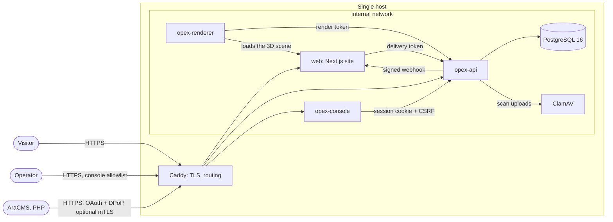

# Architecture

How the Arapoush website and OPEX fit together, as built. The original design and its reasoning are
in [the OPEX plan](../opex/OPEX-PLAN.md). Where the build differs from the plan, the
[ADRs](adr/README.md) record why.

| Document | Covers |
|---|---|
| This page | Components, deployment topology, where the code lives |
| [Data flow](data-flow.md) | Content → publish → website; preview and the visual editor; forms; 3D renders; partner changes |
| [Security model](security.md) | Trust boundaries, who authenticates how, request integrity, audit, media |
| [ADRs](adr/README.md) | Decisions that changed or fixed the design |
| [API reference](../api/README.md) | Every HTTP route, generated from the route contracts |

## Components

| Component | Code | What it does |
|---|---|---|
| Website | `apps/web` (Next.js 15, App Router) | The public site in fa (default, RTL), en and tr. Pages are static and are regenerated after a publish. |
| OPEX API | `apps/opex-api` (Fastify 5, Node 22 type stripping) | Content core. It serves the management API (console), the partner API (AraCMS), the delivery API (website), OAuth, webhooks and the audit log. |
| OPEX console | `apps/opex-console` (Next.js) | Operator UI: content editor, visual page editor, media, change requests, forms, helpdesk tickets, partners, audit. |
| 3D renderer | `apps/opex-renderer` (headless Chromium) | Renders the effervescent product images from the website's own 3D scene. |
| Content schema | `packages/schema` | Content types, field kinds and page-builder blocks. It also holds the locked overrides, the generated JSON Schema and the seed snapshot. Shared by the API, console and site. |
| PHP reference client | `clients/php-reference` | How AraCMS signs requests and verifies webhooks. Its cross-language test vectors keep it equal to the API. |
| Shared config | `packages/config` | ESLint and TypeScript presets. |

Runtime stack choices (Fastify instead of NestJS, plain SQL, PGlite in development, in-process jobs)
are in [ADR 0001](adr/0001-runtime-stack.md).

## Deployment topology

Production is a single host with `infra/docker-compose.prod.yml`.

Only Caddy is on the `edge` network. Everything else sits on `internal`, so only Caddy is reachable
from outside.

Development runs without Docker:
- `pnpm dev` runs the site;
- the `opex-api` and `opex-console` launch configurations run OPEX;
- the API uses PGlite when `DATABASE_URL` is unset.

Deployment, backups and key rotation are in the [runbooks](../opex/runbooks/).

## Where things live

| Concern | Location |
|---|---|
| Home section order and page-builder blocks | Content entry `page.home` (`layout.sections`); kinds in `packages/schema/src/blocks.ts`; render in `apps/web/components/sections/blocks/Block.tsx` |
| Site content loading | `apps/web/lib/content/index.ts` (`ensureContent()`, then synchronous loaders) |
| Route contracts (source of every API doc) | `apps/opex-api/src/**/contract.ts`, website routes in `apps/opex-api/src/openapi/site.ts` |
| Request guards | `apps/opex-api/src/auth/guards.ts` (console), `apps/opex-api/src/partner/*` (AraCMS) |
| Grants (type, field and locale access for partners) | `apps/opex-api/src/authz/grants.ts` |
| Outbound webhooks | `apps/opex-api/src/webhooks/outbox.ts` |
| Audit log and archive | `apps/opex-api/src/audit/` |
| Migrations | `apps/opex-api/src/db/` (plain SQL, applied in order) |

## Keeping this current

- These pages describe the system as built.
- A change to a component's boundary, auth or data flow updates them in the same commit. The
  `documentation-maintenance` skill lists what to check.
- The dependency graph (`graphify-out/`, rebuilt after each commit) is the cross-check: for example,
  `graphify query "what calls ensureContent"` or `graphify path "revalidate/route.ts" "outbox.ts"`.
  These pages were checked against it when written.
