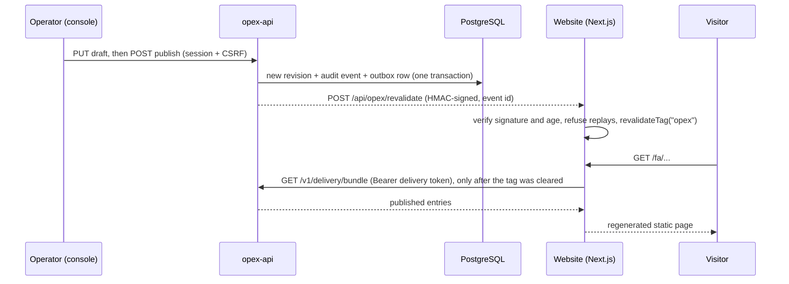
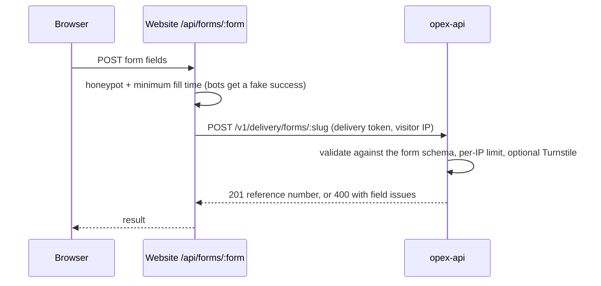

# Data flow

[Architecture](README.md) › Data flow

## 1. Published content reaches the website

Pages stay static. A publish refreshes them through one cache tag.

### How the site reads content (`apps/web/lib/content/index.ts`)

1. Pages, `generateMetadata`, the sitemap and the llms routes call `await ensureContent()`.
2. It fetches `/v1/delivery/bundle` with Next's cache under the tag `opex`. The cache has a 1-hour
   safety revalidation in case a webhook is missed.
3. The loaders stay synchronous and read what was loaded: `getDictionary`, `getTubeProduct`,
   `getEffervescentProduct`, `getPrinting` and the home layout.

When OPEX is unavailable:

| Situation | The site renders from |
|---|---|
| OPEX not configured (no `OPEX_DELIVERY_URL` or token) | Its own files: dictionaries and `content/*.json` |
| OPEX configured but unreachable | The last good bundle; at first start, the generated snapshot (`packages/schema/generated/seed.json`) |

**A build never fails because OPEX is down.** This is [ADR 0002](adr/0002-content-behind-loaders.md).

**Delivery of the webhook.** The API writes the event to an outbox in the same transaction as the
change (`webhooks/outbox.ts`). A job then delivers it at least once:
- retries back off from 1 minute up to 6 hours;
- after 24 attempts the event becomes a dead letter;
- the same outbox feeds AraCMS's webhooks (`partner:<id>` targets).

## 2. Preview and the visual editor

Draft content is never cached and never indexed.

1. The console asks for a preview token: `POST /v1/manage/preview`. The token is signed and
   short-lived.
2. The browser opens the site's `/api/opex/preview?token=…&path=…`, which does three things:
   - turns on Next draft mode;
   - stores the token in the `opex_preview` cookie;
   - redirects to the path. Only same-site paths are allowed, never an open redirect.
3. In draft mode, `ensureContent()` also fetches `/v1/delivery/preview` with the `opex-preview`
   header, with `no-store`. Those entries take precedence for that request only.

**Visual editor (P12).**
- The console's `/visual` page frames the real site in draft mode plus the `opex_edit` cookie.
- Only then does the site load `components/opex/EditBridge`; visitors never download it.
- Sections mark their content with `EditScope` (`data-opex-entry`). The bridge matches text and
  images against the entry's draft.
- Edits travel back to the console by `postMessage`. The console saves them as a normal draft, with
  the same guards and the same audit.

## 3. Website forms → inquiries and tickets

- OPEX credentials stay on the website's server; the browser never sees them.
- Submissions are stored as inquiries, which hold personal data and are encrypted at rest. They
  surface in the console's helpdesk as tickets: assign, transfer, internal notes, SLA.
- If the API answers 404, OPEX is not set up, and the form falls back to the visitor's email app.

## 4. 3D renders (P10)

The effervescent product's images are rendered from the website's own scene, so they always match
what visitors see. See [ADR 0001](adr/0001-runtime-stack.md), "P10".

1. An operator changes sizes or caps, then queues a job: `POST /v1/manage/render`.
2. `opex-renderer` claims it (`POST /v1/render/claim`, render token) and renders the images:
   - it opens the site page with `?webgl&render`, which exposes `window.__effScene`;
   - it renders every size, every cap variant, the uses image and the hero posters.
3. It uploads each PNG (`/v1/render/jobs/:id/assets`); OPEX re-encodes them to WebP.
4. It completes the job with the dimension marks.
5. The result is a new **draft** revision. An operator reviews and publishes it like any change.
   Failed jobs are retried three times.

`window.__effScene` in `apps/web/components/effervescent/EffStage.tsx` and `apps/opex-renderer/src/main.ts` must stay in
step.

## 5. AraCMS changes (partner API)

AraCMS never edits drafts directly.

1. A signed partner write becomes a **change request** (CR). The grants are checked per type, field
   and locale first.
2. Approval policies decide whether the CR auto-approves or waits for an operator. A higher
   `priority` is evaluated first, and the default is review.
3. On approval, every item must merge cleanly; one conflict moves the whole CR to `needs_rebase`.
4. An approved CR becomes a draft revision, then the normal publish flow (section 1) takes over.
   AraCMS receives `cr.state_changed` and `content.published` webhooks.

Signing, idempotency and replay protection are in the [security model](security.md#partner-api-aracms).
The PHP side is in [the AraCMS integration guide](../opex/aracms-integration.md).
